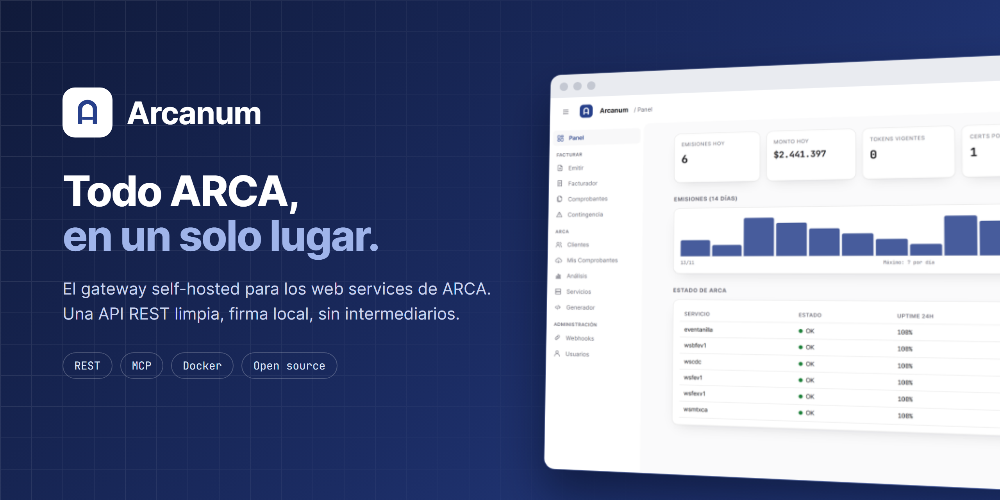
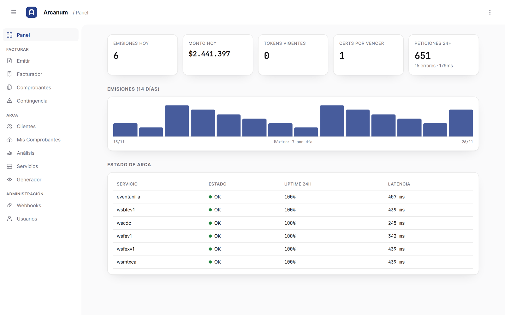
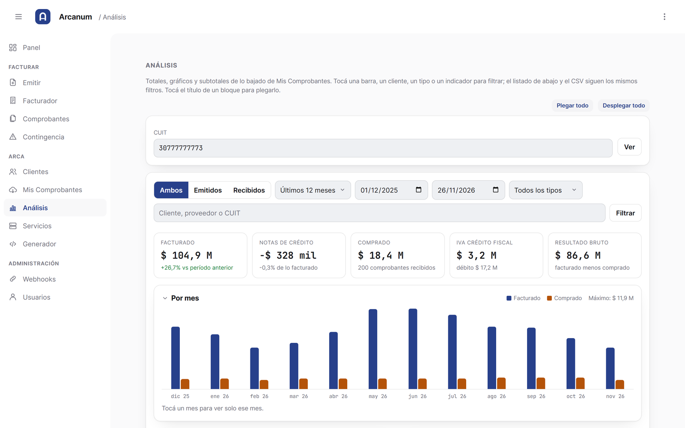
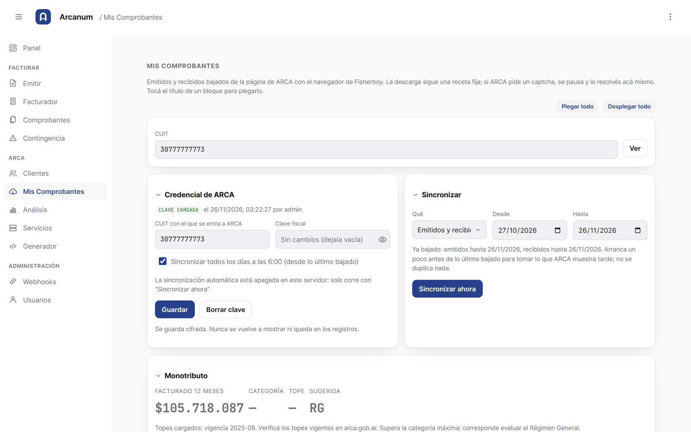
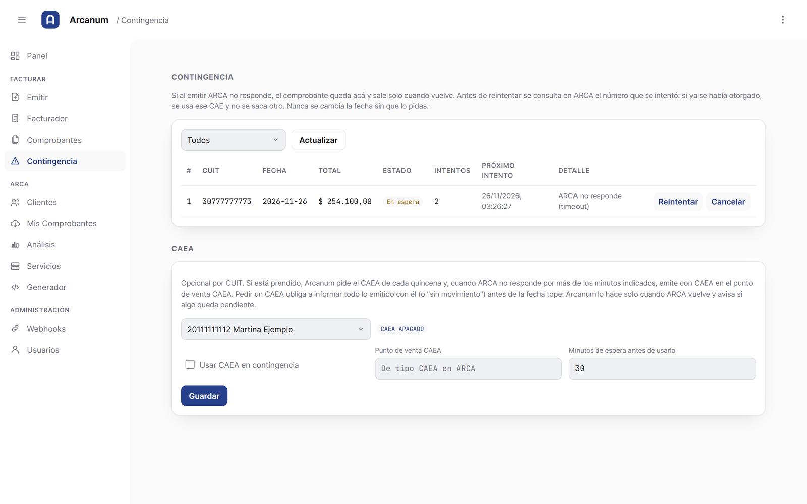
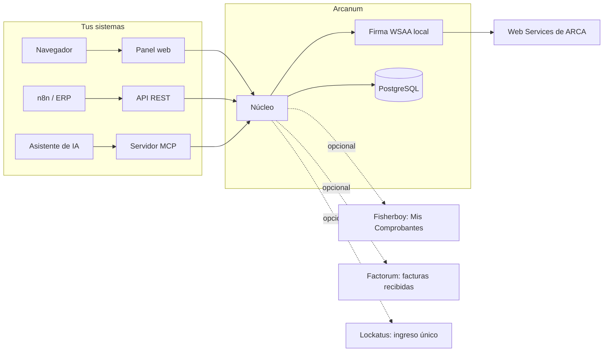

<div align="center">



# Arcanum

**Toda ARCA en una API. En tu servidor.**

Gateway REST self-hosted para los Web Services de ARCA (ex AFIP), con panel web, firma WSAA 100 % local y cero intermediarios.

[](https://github.com/diegoparras/arcanum/releases)
[](https://github.com/diegoparras/arcanum/actions)
[](https://github.com/diegoparras/arcanum/pkgs/container/arcanum)
[](LICENSE)

[**Guía de instalación (PDF)**](docs/guias/arcanum-guia-instalacion.pdf) · [**Guía de uso (PDF)**](docs/guias/arcanum-guia-uso.pdf) · [**Instalar ya**](#instalalo-en-minutos)

</div>

https://github.com/user-attachments/assets/7188d4d8-7b0b-4bc0-b6e8-178d5861e913

<div align="center"><sub>Arcanum en 90 segundos, con sonido. En alta definición: <a href="docs/media/arcanum.mp4">arcanum.mp4 (1080p)</a>.</sub></div>

---

## La historia de siempre

Son las nueve de la noche y hay que emitir la factura de un cliente desde el sistema propio. Nada del otro mundo, salvo que ARCA no tiene una API como las de ahora. Tiene **Web Services SOAP**, con WSDL que cambian sin aviso y namespaces caprichosos.

Antes de pedir *cualquier cosa*, hay que pasar por **WSAA**. Se arma un ticket de requerimiento, se **firma en CMS/PKCS#7** con el certificado del contribuyente, se manda y se recibe un *token* y una *firma*. Ese ticket dura **doce horas y no se puede pedir otro antes**: si se pierde, ARCA no da otro. Hay **un certificado por CUIT**, **endpoints distintos** para homologación y producción, y **una veintena de servicios**, cada uno con sus manías. Y un martes cualquiera **ARCA no responde**, justo cuando la factura tenía que salir.

Cada sistema que se integra con ARCA vuelve a pelear esta misma pelea. Algunas soluciones lo resuelven mandando **tu certificado y tu autenticación a un servidor de terceros**.

## Lo que cambia con Arcanum

Arcanum hace ese trabajo **una sola vez, en tu servidor**, y te deja una **API REST limpia** y un **panel web** para operarlo todo. La clave privada de cada certificado se usa solo para firmar, en memoria, y **nunca sale del contenedor**.

```
  n8n · ERP · IA · panel  ──REST──►  Arcanum  ──SOAP──►  ARCA
                                     ├─ firma WSAA local (CMS/PKCS#7)
                                     ├─ cachea el ticket 12 h y lo renueva solo
                                     ├─ traduce SOAP ⇄ JSON, reintenta y no duplica
                                     └─ PostgreSQL: clientes, certificados cifrados, auditoría
```

Lo que antes era armar el ticket, firmarlo, loguearse en WSAA, cachear, armar el sobre SOAP y parsear el XML, ahora es una llamada:

```bash
curl -X POST https://arcanum.tuempresa.com/api/wsfev1/comprobantes \
  -H "X-API-Key: TU_CLAVE" -H "Content-Type: application/json" \
  -d '{ "cuit": "30777777773", "puntoVenta": 4, "tipoComprobante": 11,
        "importeTotal": 254100, "idempotencyKey": "venta-0042" }'
```

Y vuelve el CAE, el número y el link al PDF con el QR de ARCA. Si la conexión se corta y el pedido se repite, Arcanum devuelve el mismo comprobante: **nunca emite dos veces**.

---

## Todo lo que hace

<table>
<tr>
<td width="50%" valign="top">

**Facturar sin sobresaltos**
Factura A, B, C, M y de exportación. Vista previa que valida contra ARCA antes de pedir el CAE. PDF idéntico al de ARCA, con QR. Idempotencia para no duplicar nunca.

</td>
<td width="50%" valign="top">

**Si ARCA se cae, vos seguís**
Cola de contingencia con reintentos, adopción del CAE si la respuesta se perdió y CAEA opcional. La fecha nunca cambia sin tu decisión.

</td>
</tr>
<tr>
<td valign="top">

**Mis Comprobantes, automático**
Emitidos y recibidos del portal de ARCA, bajados todos los días con el navegador de Fisherboy. Captcha o segundo factor se resuelven en vivo desde el panel.

</td>
<td valign="top">

**Números que se entienden**
Facturación, compras, IVA, principales clientes y proveedores. Un clic filtra todo. Topes de Monotributo con semáforo y recordatorio de recategorización.

</td>
</tr>
<tr>
<td valign="top">

**Constatá lo que te facturan**
Cada recibido contra ARCA (WSCDC) y su emisor contra la base de apócrifos, en segundo plano. Con Factorum, además, lectura de facturas en PDF o imagen.

</td>
<td valign="top">

**Los 25 servicios de ARCA**
Padrón A5 y A13, facturación, constatación, e-Ventanilla, agro y remitos, desde un catálogo editable en vivo y con guía de activación de cada servicio.

</td>
</tr>
<tr>
<td valign="top">

**Hecho para integrar**
API REST documentada en `/docs`, motor genérico para cualquier operación, nodo de n8n listo para pegar, webhooks firmados y servidor MCP para asistentes de IA.

</td>
<td valign="top">

**Seguro de verdad**
Firma local, cifrado AES-256-GCM, roles y alcance por CUIT, sesiones revocables, auditoría, límites por clave. Con una auditoría de seguridad completa en noviembre de 2026.

</td>
</tr>
</table>

## Cómo se ve

| | |
|---|---|
|  |  |
| **Panel.** Emisiones, certificados por vencer y el estado de cada servicio de ARCA. | **Análisis.** Facturación, compras, IVA y principales clientes, con un clic. |
|  |  |
| **Mis Comprobantes.** Emitidos y recibidos del portal, sincronizados solos. | **Contingencia.** La facturación sigue aunque ARCA no responda. |

<sub>Datos de demostración ficticios.</sub>

---

## Instalalo en minutos

Necesitás un servidor con Docker y un dominio con HTTPS.

```bash
git clone https://github.com/diegoparras/arcanum
cd arcanum
cp .env.example .env        # completá los secretos: ver la guía de instalación
docker compose up -d
```

Arcanum queda en `127.0.0.1:8094`, listo para poner detrás de tu proxy con HTTPS. También corre en **EasyPanel, Coolify, Dokploy y Portainer** con la imagen `ghcr.io/diegoparras/arcanum:latest`.

La **[Guía de instalación (PDF)](docs/guias/arcanum-guia-instalacion.pdf)** lleva paso a paso del servidor vacío al primer comprobante autorizado: secretos, Docker y EasyPanel, certificados de ARCA, homologación, producción, integraciones, backups y solución de problemas. El detalle de cada panel está también en [DESPLIEGUE.md](DESPLIEGUE.md).

> **Empezá por homologación.** Con `ARCANUM_ENV=homo` y un certificado de prueba, `node src/tools/prueba-homologacion.js` recorre todo el circuito contra los servidores de prueba de ARCA, sin riesgo.

---

## Referencia

<details>
<summary><b>Arquitectura</b></summary>



- **Firma WSAA 100 % local:** el ticket de requerimiento se firma en CMS/PKCS#7 en memoria, con `node-forge`. Ningún SDK llama a terceros.
- **Tickets cacheados:** por CUIT, servicio y entorno, cifrados en la base. Los pedidos simultáneos comparten un solo login; si ARCA rechaza por ticket vencido, Arcanum reintenta solo.
- **Catálogo declarativo:** endpoints, namespaces, autenticación y guía de activación de cada servicio, editable en vivo por el superadmin. Las direcciones solo pueden ser `https` de dominios de ARCA.
- **Multi-CUIT y multi-entorno:** varios contribuyentes en una instancia; homologación y producción se cambian desde el panel.

</details>

<details>
<summary><b>Servicios de ARCA cubiertos</b></summary>

Todos se llaman con el motor genérico (`POST /api/ws/{servicio}/{operación}`). Los marcados **dedicado** tienen además endpoints REST con validación.

| Servicio | Para qué | Soporte |
|---|---|---|
| **WSFEv1** | Factura electrónica nacional (A, B, C, M), CAE y CAEA | **dedicado** |
| WSFEXv1 | Factura de exportación | dedicado |
| WSMTXCA | Factura con detalle de ítems | dedicado |
| **Padrón A5** | Constancia de inscripción, datos del contribuyente | **dedicado** |
| **Padrón A13** | Monotributo | **dedicado** |
| WSCDC | Constatación de comprobantes | **dedicado** |
| e-Ventanilla | Comunicaciones del domicilio fiscal electrónico | **dedicado** |
| WSBFEv1, WSCT, WSFECRED | Bonos fiscales, turismo, factura de crédito MiPyME | genérico |
| WSCTG, WSLPG, WSLSP, WSLUM, WSLTV | Granos, liquidaciones del agro | genérico |
| WSREMCARNE, WSREMHARINA, WSREMAZUCAR | Remitos electrónicos | genérico |

</details>

<details>
<summary><b>Endpoints principales</b></summary>

| Endpoint | Qué hace |
|---|---|
| `POST /api/wsfev1/comprobantes` | Emite y devuelve el CAE (numeración automática, idempotencia, validación de importes) |
| `POST /api/wsfev1/comprobantes/vista-previa` | Valida un comprobante sin emitirlo y devuelve el número que le tocaría |
| `GET /api/wsfev1/consultar` | Consulta un comprobante en ARCA |
| `GET /api/padron/a5/{cuit}` · `a13` | Padrón |
| `POST /api/ws/{servicio}/{operación}` | Cualquier operación de cualquier servicio del catálogo |
| `GET /api/services` · `/{id}/operaciones` | Catálogo e introspección del WSDL en vivo |
| `GET /api/comprobantes` · `/export.csv` · `/{…}/pdf` | Comprobantes, CSV y PDF con QR |
| `GET /api/mis-comprobantes/{cuit}` · `/analisis` | Mis Comprobantes y su análisis |
| `POST /api/constatacion` | Constata una lista de comprobantes (WSCDC y apócrifos) |
| `GET /api/monotributo/{cuit}` | Facturado en 12 meses contra el tope de la categoría |
| `GET /api/metrics` · `/metrics` | Métricas en JSON y en formato Prometheus |
| `GET /docs` | Documentación interactiva (OpenAPI) |

La API se autentica con `X-API-Key`, con `Authorization: Bearer <clave>` o con la sesión del panel. Las emisiones aceptan `Idempotency-Key` (o `idempotencyKey` en el cuerpo); la clave vale por CUIT y entorno.

</details>

<details>
<summary><b>Claves de API</b></summary>

Además de la clave maestra, en **Usuarios → Claves de API** se crea una clave por integración:

- **Rol:** `lectura` (solo consulta, ni por REST ni por MCP puede emitir), `operador` (emite) o `admin`.
- **CUITs permitidos:** la clave queda limitada a esos contribuyentes. Un CUIT mal tipeado es un error, nunca "todos".
- **Vencimiento y rotación** con días de gracia, para cambiar la clave sin cortes.
- **Límite por minuto** (120 por defecto, `ARCANUM_CLAVE_LIMITE_MIN`); al pasarse responde `429` con `Retry-After`.
- **Uso por clave:** pedidos, errores, rechazos, CUITs consultados y últimos pedidos.
- **Aviso de uso anómalo** (`clave_anomala`) si consulta muchos CUITs o acumula rechazos.
- **Suite Escriba** opcional: **Puede abrir sesiones de la suite**, con un **rol tope** (`operador` por defecto). Es lo que usa Factorum para que la gente entre a Arcanum sin volver a loguearse. El tope `admin` o `superadmin` solo lo pone un superadmin, y una clave con CUITs permitidos llega como mucho a `operador`.
- La clave se muestra **una sola vez**; Arcanum guarda solo su hash SHA-256.

</details>

<details>
<summary><b>Suite Escriba: pase entre apps</b></summary>

Con Factorum conectado, se pasa de una app a la otra **sin volver a loguearse**. Arriba a la derecha aparece la **grilla de la suite** (solo si hay alguna app conectada): tocando **Factorum**, Arcanum le pide un pase para esa persona y el navegador entra directo. Y al revés: el botón de Factorum para abrir Arcanum trae a la persona con su usuario de Arcanum. Si las dos apps están federadas con Lockatus el paso ya es directo por el SSO; el pase convive con eso. Contrato: [docs/suite-pase.md](docs/suite-pase.md).

**De Arcanum a Factorum** (`GET /api/suite/apps`, `POST /api/suite/abrir/factorum`): Arcanum llama a `POST <FACTORUM_URL>/api/suite/pase` con el token de Factorum, que viaja solo al destino para el que se cargó y nunca sale al navegador, y la identidad de la sesión (email, nombre, rol y CUITs). Cualquier sesión del panel puede hacerlo, también la de rol `lectura` (en Arcanum no modifica nada), con la misma protección CSRF que el resto del panel. La persona necesita un **email** en su usuario (Usuarios → Editar).

**De Factorum a Arcanum** (`POST /api/suite/pase`, solo con una clave de Arcanum que tenga **Puede abrir sesiones de la suite**, y `GET /suite/entrar?pase=...`):

- **Quien ya tiene usuario** (por email) entra con **su rol y sus CUITs de Arcanum**: venir de Factorum no lo escala. Si tiene pendiente cambiar la contraseña inicial, primero tiene que entrar con ella.
- **Quien no**, se da de alta con origen `factorum`, el rol traducido (`usuario` → operador) y los CUITs que trae, validados como en cualquier alta. No tiene contraseña: no entra por el login normal. Se puede apagar (`ARCANUM_SUITE_CREAR_USUARIOS=0` o el menú **Suite Escriba**).
- El rol queda **topeado** por la clave y los CUITs se **intersecan** con los de ella.
- El pase son 32 bytes aleatorios, sirve **una vez** y **vence a los 60 s**; en la base queda solo su SHA-256. `GET /suite/entrar` abre la misma sesión revocable que el login y va siempre a `/`. En cada pedido se relee el usuario: desactivarlo, borrarlo o bajarle el rol se nota al instante.

Arcanum necesita su **URL pública**: `ARCANUM_PUBLIC_URL` o el menú **Suite Escriba (pase entre apps)** (superadmin), que también muestra los últimos pases emitidos, usados y rechazados. Cómo conectar las dos apps: [DESPLIEGUE.md](DESPLIEGUE.md#suite-escriba-pase-entre-arcanum-y-factorum).

</details>

<details>
<summary><b>Servidor MCP para asistentes de IA</b></summary>

`POST /mcp` publica un servidor [Model Context Protocol](https://modelcontextprotocol.io) sin estado, con clave de API. **Todas las herramientas son de solo consulta**; un lote acepta hasta 10 llamadas y cada una cuenta para el límite de la clave.

| Herramienta | Devuelve |
|---|---|
| `padron` | Razón social, condición frente al IVA, domicilio y actividades |
| `comprobante` · `comprobantes_recientes` | Un comprobante o los últimos, con filtros |
| `ultimo_comprobante` · `puntos_de_venta` | Numeración y puntos de venta habilitados |
| `estado_arca` | Si ARCA responde y el estado de cada servicio |
| `riesgo_fiscal` | Semáforo que cruza padrón y base de apócrifos |
| `comunicaciones_ventanilla` | Comunicaciones de e-Ventanilla (sin marcarlas como leídas) |
| `vencimiento_certificado` | Hasta cuándo sirve cada certificado |
| `vista_previa_comprobante` | Revisa un comprobante sin emitirlo |
| `mis_comprobantes` · `topes_monotributo` · `constatacion_recibidos` | Datos de Mis Comprobantes |
| `facturas_recibidas` · `factura_recibida` · `resumen_facturas_recibidas` · `verificar_factura` | Facturas recibidas (con Factorum) |

Para que un asistente facture: `vista_previa_comprobante`, una persona aprueba, y la emisión va por la API REST con una clave de rol `operador`.

</details>

<details>
<summary><b>Mis Comprobantes, constatación y Monotributo</b></summary>

ARCA no publica Mis Comprobantes como Web Service: Arcanum lo baja operando el portal con la sesión de agente de [Fisherboy](https://github.com/diegoparras/fisherboy) (1.12.1 o superior).

- Una **receta** hace el login, abre Mis Comprobantes y pide los datos directo a ARCA en JSON. Los rangos largos se parten en tramos de un año; una sincronización abarca hasta 3 años.
- Si ARCA pide **captcha o segundo factor**, la vista en vivo muestra el navegador y una persona lo resuelve. Un operador solo puede intervenir cuando ARCA pide una persona, y solo en el login o en Mis Comprobantes.
- La **clave fiscal** se guarda cifrada y nunca vuelve por la API. Si ARCA la rechaza, Arcanum la bloquea y no reintenta, para no bloquear la cuenta.
- La sincronización es **incremental** y puede ser **diaria** (`ARCANUM_MC_HORA`). Una corrida en curso se puede cancelar.
- **Constatación masiva:** cada recibido contra WSCDC y su emisor contra apócrifos, en segundo plano y con reintento con CUIL, DNI y consumidor final.
- **Topes de Monotributo:** 12 meses de emitidos contra el tope de la categoría, semáforo al 80 % y 100 %, categoría sugerida y recordatorio de recategorización.

</details>

<details>
<summary><b>Contingencia, PDF, backups y avisos</b></summary>

**Contingencia.** Emitiendo con `"contingencia": true`, si ARCA no responde el comprobante queda en cola (`202`) y sale solo cuando vuelve. Si el pedido llegó pero la respuesta no, se consulta ese número y se adopta el CAE. Con CAEA (opcional por CUIT) se emite igual si ARCA sigue caído, y se informa todo al volver. **Traer lo emitido por fuera** suma lo facturado en la web de ARCA u otro sistema.

**PDF.** Por defecto, igual al de ARCA (original, duplicado y triplicado) y con su mismo nombre de archivo. Se puede elegir otro modelo y una plantilla de nombre. Los datos del emisor se completan del padrón y se editan en Clientes → Datos fiscales.

**Backups.** Diarios y cifrados, en `/data/backups` (se guardan los últimos 14). Necesitan `ARCANUM_MASTER_KEY` o `ARCANUM_BACKUP_KEY` por entorno. Se restauran con `src/tools/restaurar-backup.js`, primero en simulacro.

**Avisos.** Webhooks firmados con HMAC y correo opcional: `comprobante_emitido`, `arca_caido`, `cert_por_vencer`, `clave_por_vencer`, `clave_anomala`, `comunicacion_nueva`, `tope_monotributo`, contingencia, CAEA, Mis Comprobantes, backups y cambios de configuración.

</details>

<details>
<summary><b>Seguridad</b></summary>

- **Firma local** y **cifrado en reposo** (AES-256-GCM) de claves privadas, claves fiscales, tickets y tokens de servicio.
- **Roles** (superadmin, admin, operador, lectura) y **alcance por CUIT**. El rol lectura falla cerrado: solo `GET` y una lista cerrada de `POST` que no escriben nada en Arcanum (vista previa, constatación y, desde una sesión, abrir otra app de la suite).
- **Sesiones revocables**, protección CSRF, CSP y cabeceras de seguridad, límite de intentos de ingreso por IP, usuario y global.
- **Endpoints de ARCA validados**, protección SSRF con resolución DNS en webhooks, tokens de servicio atados a su destino.
- **Auditoría** de pedidos con usuario e IP, imagen sin root y cadena de publicación verificada (tests, lint y `npm audit` antes de cada imagen).

Arcanum pasó una auditoría de seguridad completa en noviembre de 2026. Para reportar una vulnerabilidad, ver [SECURITY.md](SECURITY.md).

</details>

<details>
<summary><b>Versiones y publicación</b></summary>

Cada push a `main` corre los tests, el lint y `npm audit`, y si pasan publica la imagen multi-arquitectura (amd64 y arm64) en GHCR como `:latest` y `:X.Y.Z`, con su Release y sus notas. Cada versión dice qué cambia desde una sola fuente, el [CHANGELOG](CHANGELOG.md): aparece en el log del contenedor al arrancar, en el panel después de cada actualización (menú → Novedades) y en GitHub.

</details>

---

## Parte del Ecosistema Escriba

Arcanum se usa solo, y se potencia con el resto de la suite: **[Fisherboy](https://github.com/diegoparras/fisherboy)** baja Mis Comprobantes, **Factorum** lee las facturas recibidas y **Lockatus** da el ingreso único a todas las aplicaciones.

## Contribuir

Los aportes son bienvenidos. [CONTRIBUTING.md](CONTRIBUTING.md) explica cómo correr el proyecto, los tests y la convención de commits.

```bash
npm install
npm test
```

## Licencia

[MIT](LICENSE): podés usarlo, modificarlo, redistribuirlo y venderlo, también dentro de un producto o servicio propio, manteniendo el aviso de copyright y la licencia. Hasta la versión 2.1.0 Arcanum se publicó con licencia Apache-2.0; `src/services/apoc.js` incluye un aporte de un tercero bajo esa licencia, detallado al final de [LICENSE](LICENSE).

<sub>Arcanum es un proyecto independiente, sin relación con ARCA ni respaldo de ARCA. Diego Parras · Ecosistema Escriba.</sub>
